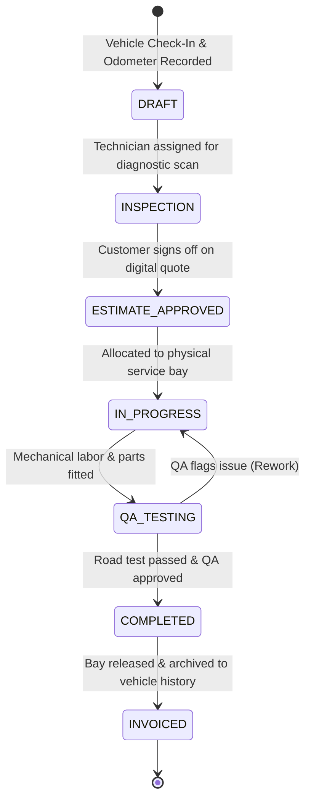
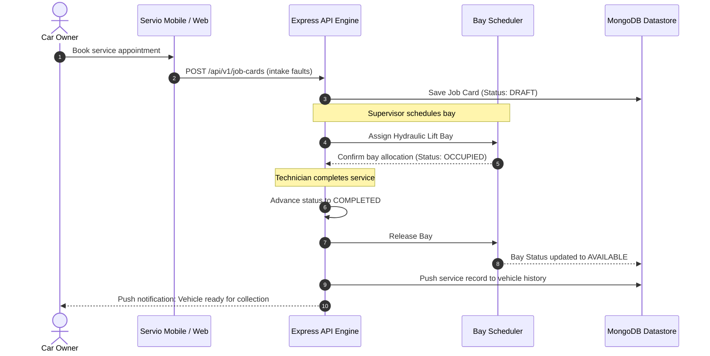

# Servio Workshop Platform
> **Full-stack vehicle maintenance & workshop management system: hydraulic bay conflict-resolution scheduling, digital job cards state machine, and customer telematics history.**

[](https://github.com/osama1404/servio-workshop-platform/actions)
[](https://react.dev/)
[](https://nodejs.org/)
[](https://www.typescriptlang.org/)
[](https://www.mongodb.com/)
[](https://www.docker.com/)
[](LICENSE)

---

## 🚘 Project Overview

Originated from a published Google Play automotive platform graduation project, **Servio** is designed to digitize aftermarket automotive workshops across the GCC. Independent garages frequently suffer from physical bay scheduling bottlenecks, lost paper job cards, and disconnected customer communication.

Servio decouples two core workflows:
1. **Car Owner Lifecycle:** Service booking, transparent quotation approvals, vehicle odometer history, and real-time maintenance status.
2. **Workshop Operations Hub:** Physical lift bay capacity planning, digital job cards with strict state-machine governance, technician labor assignment, and automated 5% VAT invoicing.

---

## 🏛️ System Architecture & Workflow

### 1. Job Card Lifecycle State Machine



---

### 2. Service Dispatch Sequence Diagram



---

## 🛠️ Key Capabilities

- **Atomic Bay Conflict Prevention:** Enforces that no two active job cards occupy the same hydraulic lift or diagnostic bay simultaneously.
- **Strict State-Machine Governance:** Prevents accidental or fraudulent status jumps (e.g. prohibits billing a customer before diagnostic inspection and road-test QA are completed).
- **Dynamic Ledger & Tax Engine:** Recalculates line-item labor hours, OEM replacement parts, and 5% UAE VAT in real time.
- **Vehicle Telematics Archive:** Appends completed service records automatically into the car's permanent digital service passport.

---

## 🚀 Quickstart Guide

### Option A: Run via Docker Compose (Recommended)
```bash
# Clone the repository
git clone https://github.com/osama1404/servio-workshop-platform.git
cd servio-workshop-platform

# Spin up MongoDB, API Server, and Web Dashboard
docker compose up -d

# Dashboard will be available at http://localhost:3000
# REST API will be available at http://localhost:5000
```

### Option B: Local Node.js Execution
```bash
# 1. Backend API & Tests
cd backend
npm install
npm run build
npm test
npm start

# 2. Frontend Dashboard
cd ../frontend
npm install
npm run dev
```

---

## 📡 REST API Reference

| Endpoint | Method | Description |
| :--- | :--- | :--- |
| `/api/v1/health` | `GET` | Health check and engine uptime status |
| `/api/v1/workshops/:id/bays` | `GET` | Real-time bay occupancy metrics and availability |
| `/api/v1/bays/assign` | `POST` | Assign available service bay to a job card |
| `/api/v1/bays/release` | `POST` | Release service bay back to available pool |
| `/api/v1/job-cards` | `GET` | List active workshop job cards |
| `/api/v1/job-cards/:id/transition` | `POST` | Advance job card status through state machine |
| `/api/v1/job-cards/:id/items` | `POST` | Append billable labor or replacement parts |
| `/api/v1/vehicles/:id/history` | `GET` | Query vehicle service passport and maintenance logs |

---

## 📄 License
This project is licensed under the MIT License - see the [LICENSE](LICENSE) file for details.
